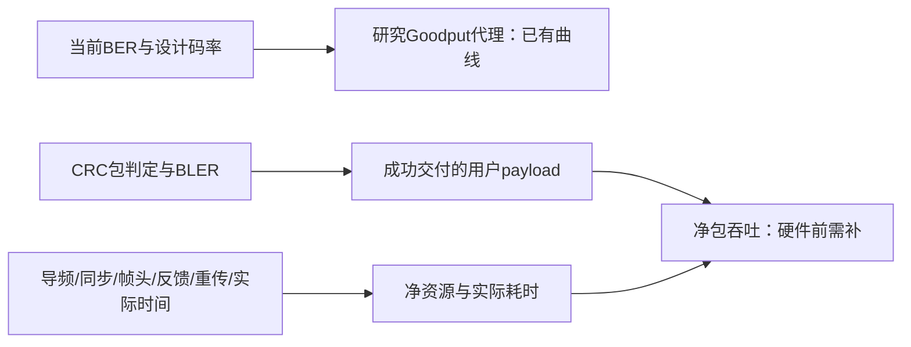

# 新构造结果的边界与读图说明

首版日期：2026-10-10，Asia/Shanghai。以后采用末尾追加修订。

**本轮最确定的进展是：我们找到了整形集合选择中的关键错位，并获得接近目标的实际星座分布。通信性能、等功率收益和整流器直流输出，则需要分别验证。** 这些是连续的研究环节，前一环节通过不自动代表后一环节通过。

下面逐图解释“已经知道什么、还不知道什么、下一步怎样补”。图均来自已有实验，本说明没有启动新仿真。图中SNR按原实验标签保留，不能把不同链路的标签直接横向比较。单载波和code-only结果的物理 $E_s/N_0$ 为标签减去3.0103 dB；B4采用其原OFDM噪声与资源定义。

## Material Passport

- Origin Skill：academic-research-suite / experiment-agent。
- Origin Mode：validate，既有结果解释。
- Origin Date：2026-10-10。
- Verification Status：ANALYZED；核对现有CSV、README、图像和方法，未重新运行蒙特卡洛。
- Version Label：boundary_reading_v1。

## 1. 集合选对了，具体意味着什么

可以把整形位S理解为“为了让整个码字长成目标分布，需要配合前面位作出的选择”，把信息位I理解为“用户自由填入的消息”。S应放在**前序位已知后比较容易预测**的位置，而I应能容纳随机消息。接收端还要能从带噪观测恢复I，因此I的通信可靠性也是另一项要求。

**读图：** 蓝色为原GA前缀分区，橙色为新分区。每一行对应一个p；横轴依次为S、I、F，纵轴为独立源样本评价得到的平均源条件熵。越接近0，表示给定前序位后越容易预测；越接近1，表示越接近不可预测的公平比特。p=.5没有整形位，所以S处空白，不能解释成“存在熵为0的S”。

原分区在p=.1时，把平均源条件熵约.46的位置放入S，而I平均仅约.43；新分区的S接近.05，I接近.94。这个结构更符合“可预测的位置承担整形、难预测的位置容纳随机消息”。评价样本独立于构造seed9001的200个源码字，避免用同一批样本选集合后再证明自己选得好。

技术上，源条件熵考察 $H(U_i\mid U^{i-1})$；通信可靠性还要考虑接收观测Y，即 $H(U_i\mid U^{i-1},Y)$ 或相应错误率估计。**GA本身没有因此被否定：原来把通信排序直接用于S选择，回答的是不同问题。** 新方案固定原K和S数量，用源条件熵选S，再在剩余位置按通信GA选I/F。没有给I增加源高熵硬门限；图中I平均熵改善也不表示每个I都具有严格高熵保证。

**边界和下一步：** 此图支持集合错位及修正后的源熵结构，不能直接预测带噪BER。S的源构造、I的信道排序、接收LLR与SC译码契约需要分别检查。更详细的源/信道极化概念可参照[Source Polarization](https://arxiv.org/abs/1001.3087)；这篇基础工作不能直接替本工程的混合集合选择证明渐近性能。

## 2. PMF门禁通过，为什么仍不能说“p完全精确”

像按食谱分配16种糖果：目标比例是食谱，有限批次装出的比例是实际样本。通过门禁表示偏差小于我们登记的容忍度，仍允许存在可测的有限偏差。

**读图：** 圆点为三个seed合并后的经验TV，方点为各seed的经验TV；上方短线延伸到bootstrap单侧95%上界。水平虚线.05是事先规定的门槛，所有上界都在它下面。

TV衡量16个星座点的**联合符号分布**总体偏差：

$$
\operatorname{TV}(P,Q)=\frac12\sum_{x\in\mathcal X}|P(x)-Q(x)|.
$$

| p | 汇总经验TV | 汇总单侧95%上界 | 最差seed上界 |
| --- | ---: | ---: | ---: |
| .5 | .00432 | .00802 | .01602 |
| .4 | .00968 | .01180 | .01732 |
| .3 | .01242 | .01383 | .01666 |
| .2 | .02201 | .02306 | .02511 |
| .1 | .02553 | .02615 | .02743 |

数据为N1024，每配置3 seed×80帧，2000次整码字bootstrap。整码字作为统计簇，避免把同一码字内相关符号假装为独立样本。上界仍依赖有限样本与bootstrap适用性，是统计估计，不是对任意消息、任意未来运行的确定性保证；五个p及逐seed区间也没有由此变成一个同时覆盖所有配置的95%保证。

这里target是请求p所定义的目标分布，model是当前目标位概率构成的参考模型，empirical来自实际16星座点计数。**没有把实际相关标签位的边缘概率相乘，当作已测得的联合分布。** p是目标参数，经验边缘率和联合PMF仍应单独报告。

原结果README的“gate未执行”描述的是该次仿真入口当时的动作；后续从保存的计数执行门禁分析，记录在同目录`POSTHOC_GATE_ADDENDUM.txt`和`pmf_gate_status.csv`。不能把历史README的一句状态和后来完成的分析混为同一时刻。

**边界和下一步：** 门禁支持当前参数、随机消息、冻结位F=0及该构造的符号分布接近目标，不证明整个N符号码字与独立目标源的联合分布都接近，也不证明通信可靠或渐近收敛。后续遇到新的码率、非随机载荷、CRC/帧头或硬件波形，应重新核对实际分布。

## 3. N=256与1024，能解释多少码长问题

两个码长就像观察楼梯的两级：可以看出这两级之间的变化，不能保证整条楼梯后面一直按同样方向走。

**读图：** 左图为TV和汇总上界，越低越接近目标；右图为实际发送符号平均功率相对同码长p=.5的比值。新集合下，p=.1的TV由.03106降至.02553，p=.3由.01857降至.01242；p=.4点估计则由.00788升至.00968，没有全面单调下降。不同码长的采样不确定性也不同。

发送能量相对值已较稳定，例如p=.1由1.6144到1.6215。这表示两个有限长度下的符号统计能量相近，并不意味着时域峰值、硬件直流输出或完整码字分布也已经收敛。

**边界和下一步：** 此图支持新构造在两个长度都通过当前PMF门禁，并显示部分p的偏差缩小。它既不能证明 $N\to\infty$ 时收敛，也不能证明码长因素完全不存在。原集合的大偏差在更换集合后显著缩小，使“当前主要问题来自集合错位”更有实验证据；严格渐近论证还需核对随机/确定性非信息位规则、集合条件和固定码率是否满足所引用定理。

## 4. 分布正确以后，为什么BER模型仍然很乐观

配方正确与通信不出错是两件事。GA排序可以提供选位置的近似依据，但“将这些近似可靠性合成绝对BER”还包含模型假设；SC前面一个决策错了，也可能影响后面的决策。

**读图：** 带圆点的实线是SC仿真平均BER，误差棒来自5个独立重复的t区间；虚线是GA/BER估计。纵轴为对数轴，垂直相隔一个大刻度约表示十倍差距。这是code-only诊断，不能与16QAM完整链路曲线当作相同实验。

取仿真确实位于 $10^{-4}$—$10^{-1}$ 区间的标签3 dB点，CSV给出：

| p | SC仿真平均BER | 模型BER | 仿真/模型 |
| --- | ---: | ---: | ---: |
| .5 | .0004357 | .000003318 | 131.3 |
| .4 | .0004427 | .000006643 | 66.6 |
| .3 | .001947 | .00008492 | 22.9 |
| .2 | .04500 | .004600 | 9.78 |

倍数分母明确是模型BER。p=.1在该点的仿真BER为.15485，仍未进入上述瀑布窗口；它虽只有约1.37倍偏差，也不能用来宣称“低BER模型已吻合”。标签3.25 dB的部分重复观察到零错误，仍保留原始计数，不能把它称为真实BER=0或误码地板。

本次预测已使用**实际S与实际I索引**，没有继续用“GA跳过S个位置”代替新I集合。因此修复索引错位后仍存在明显模型差距。它说明目前绝对BER估计不足以可靠承担优化中的硬约束；此图没有把差距唯一归因于GA、冻结位F=0或某一个接收因素。

## 5. 接收度量“未匹配”是什么意思，和构造修正什么关系

构造修正解决“发出的码字是否长成目标样子”。接收匹配解决“接收机计算某个候选有多可能时，有没有使用对应的概率与约束”。把新的S集合选对，不会自动更新LLR或译码器。

上面的F19图及其README明确：本轮固定plain SC，没有额外加入源先验，以隔离构造变化。它验证的是该固定接收机下的结果，**尚未验证匹配先验接收机能改善多少**。这也是本轮继续采用既有接收流程的适用范围，不能写成“改S后通信模型全部闭合”。

这是机制示意图，不是新增实测结果。下一步先用直接似然参考核对噪声、发送缩放和LLR定义，再研究先验应该在解调/译码的哪一层进入，避免重复计入；之后拆分bit-channel估计误差与有限长SC误差传播。不能简单往现有LLR加一个先验项就宣布匹配完成。

## 6. B4独立验证通过，20/24 dB为什么仍然是失败边界

训练集用于选规则，独立样本用于检查规则能否在新信道上复现。低SNR没有满足要求的候选时，选择“相对最好”的回退方案，可以让系统继续工作，但不能让原本未满足的要求变成通过。

**读图：** 上图蓝线是seed1042验证的BER均值上置信端点，必须低于红线.10；下图是Goodput均值下置信端点，必须高于红线.25。两项都满足才算登记通信门槛通过。

| 标签SNR | 冻结一般码本策略 | BER上端点 | Goodput下端点 | 含义 |
| --- | --- | ---: | ---: | --- |
| 20 | 均匀p=.5 | .22273 | .30456 | BER失败，最大Goodput回退 |
| 24 | 均匀p=.5 | .14031 | .33686 | BER失败，最大Goodput回退 |
| 28 | 均匀p=.1 | .09571 | .26021 | 两项通过，但BER裕量较小 |
| 32 | 均匀p=.1 | .06217 | .26986 | 两项通过 |
| 36 | 均匀p=.1 | .03648 | .27726 | 两项通过 |
| 40 | 均匀p=.1 | .01830 | .28249 | 两项通过 |

训练seed42、30个Rayleigh信道；冻结码本后验证seed1042、30个新信道。保护带候选在查看独立验证前冻结，随后用seed2042验证：训练筛选更保守，使用BER上端点≤.08、Goodput下端点≥.27；验证仍检查原.10/.25门槛。

28/32/36/40 dB保护带策略分别为好信道偏信息、好信道偏能量整形、均匀p=.1、均匀p=.1；这四点通过原门槛。20/24仍为回退点。CSV中的`point_pass`或一般码本的`communication_gate_pass`可能在不要求gate的fallback行被流程逻辑置为1；**必须同时读取reason和gate_required以及实际指标，不能把所有1数成通信门槛通过。**

**边界和下一步：** .10/.25是与历史研究衔接的登记标准，不等于最终IoT应用要求。当前验证只覆盖六种候选和六个SNR点、当前信道生成机制，没有证明任意SNR、任意CSI和全部27组合最优；两点之间连线只是读图辅助。

## 7. 均值的区间通过，不代表每一次信道都通过

班级平均成绩超过及格线，不代表班里每个学生及格。上节的区间描述**30个信道的平均性能估计有多不确定**，并非覆盖95%的单次信道结果。

例如28 dB均匀p=.1的BER平均约.08544，上端点约.09571。这支持当前平均门槛；不能从.09571推出“95%的信道BER都≤.10”，更不能推出“任何瞬时信道都满足要求”。上节门槛图就是平均层面的证据，不是逐信道失约率图。

**下一步：** P3应增加逐信道BER/Goodput同时违反约束的比例、尾部性能和对应区间，并说明策略获得的CSI、决策时延及CSI误差。已有逐realization记录可以先做描述性重分析；如果要把某个失约概率作为正式要求，应先登记容忍度，再用未参与调参的测试集验证。不能用现有均值门槛替代这个决定。

## 8. 为什么“接收能量更高”还不能叫等功率优化收益

两个水泵比谁送到终点的水多，如果一个从入口就抽了更多水，终点更多不能全归功于送水策略。当前固定星座幅度尺度，改变p会改变实际平均发射符号功率。

**读图：** 各面板对应原SNR标签，p=.5归一为1，p=.1约为1.615。各SNR面板都呈类似趋势，因为图统计的是加噪前符号能量；噪声变化不应被解释为该能量变化的原因。这说明p变小确实更常选取当前映射中的大幅度点，也说明发射功率已经不同。

一般B4码本seed1042在28 dB的接收代理为.0256089，p=.5参考为.0159196，差值.0096893；相对参考约为60.9%。其他高SNR点约为60%上下。**.0096893是代理量的绝对差，不能称为增加.969个百分点；相对百分比需要除以同一点的p=.5参考值。**

**边界和下一步：** 当前数据支持原功率口径下的接收代理差异，不能把全部差异归因于信道自适应或分组策略效率。P1应按含CP/padding的发送时域平均功率，用独立校准样本确定每策略一个全局幅度系数，评估时冻结；所有策略固定同一物理噪声，同时调整接收星座/LLR的缩放。归一化后可能仍有收益、变小、消失或反转，都是真实研究结果。

## 9. RF均方和直流收能中间，还缺一段物理链路

RF代理量描述接收波形的平均平方幅度；设备真正获得的电能要经过整流器和负载。当前仿真没有这段转换，因此现有能量图的数值不能当作电池充电量或DC功率。

示意图只展示测量链条，没有新实验数据。上节的`energy_p`及保护带图能支持RF代理量的差异，**不能支持DC提升**。还需研究波形峰值、削顶、非线性收能与输入功率区间，并进行RF–DC标定。同平均RF功率也不自动意味着相同DC输出；关于非线性整流器模型改变波形设计的依据，可参照[Waveform Design for Wireless Power Transfer](https://arxiv.org/abs/1604.00074)。这里没有给当前16QAM链路套用未标定的转换公式。

## 10. Goodput通过，为什么仍缺CRC和净吞吐

当前Goodput大致回答“资源中有多少比例的信息比特判对”，实际数据包通常回答“这一包是否完整正确并被协议接受”。一包里只错几位，也可能整包重传；因此二者不能直接互换。

单载波当前实现为 $G=R_{\mathrm{total}}(1-\mathrm{BER})$；B4再按其CP、padding和信息子载波比例修正资源分母。它保留了当前研究的比特与OFDM资源口径。上面的门槛图可以显示这个G通过.25，却没有测量CRC包成功率、同步开销、CSI反馈、导频、帧头或重传后的净包吞吐。

这是指标关系示意，没有包级数据。下一步至少记录BLER，补CRC后的包成功判定，并同时报告研究Goodput和真实净吞吐，防止用旧指标直接宣称应用可用。

## 11. 接下来每一阶段补的是哪条缺口

| 阶段 | 现在的证据 | 需要新增的证据 |
| --- | --- | --- |
| P1 等功率 | 原幅度尺度下RF代理差异 | 含CP/padding的独立校准、固定噪声、冻结缩放、功率偏差验收 |
| P2 可靠性模型 | 正确实际I下GA仍明显乐观 | 直接似然/LLR契约、实际PMF下调制参考、有限长误差与预测误差范围 |
| P3 27组合选择 | 六候选训练与两批独立验证 | 27组合候选内参考、逐信道失约率、独立测试、明确应用要求 |
| P4 硬件前 | 数字仿真RF均方 | 整流非线性、CSI误差、峰值/削顶、同步与CRC净吞吐 |
| P5 USRP | 尚无本轮新硬件对照 | 有线闭环、RF–DC标定、静态空口、等功率自适应切换 |

## 12. 本说明的核验记录

所有数字直接核对对应目录的`pmf_gate_status.csv`、`blocklength_comparison.csv`、`model_gap_summary.csv`、`fixed_policy_holdout_summary.csv`和`guardband_policy_test_summary.csv`。图中的实线/虚线、门槛方向及有限长度变化已视觉核验；图片路径逐项检查。接收代理百分比按同点p=.5参考作为分母，不混用单载波与OFDM归一化。

统计解释检查覆盖11/11类：聚合反转没有由此判定为不存在；平均对单次信道的生态谬误已明确限制；选择/碰撞偏差不用于机制断言；基率忽略在此不适用；训练选择带来的回归均值由独立seed验证隔离；不删除零错误重复或回退点；多配置比较不宣称同时95%保证；网格与候选冻结记录保留；RF到DC及单一BER差距原因没有被当作因果证明；反向因果不用于该控制仿真解释。此检查是读图解释范围的审查，不是新统计认证。

Rule reflection：已有规则已要求先直觉后公式、说明图的证据边界及相对变化的分母；本说明落实这些规则，没有新增durable rule。周报与任务入口由本轮主任务统一追加记录。

## 2026-10-10 追加：逐信道统计已从既有独立验证数据补出

本补充更新第7节“下一步可重分析”的状态：已对冻结策略对应的seed1042/2042既有原始记录逐信道重分析，没有新增正式蒙特卡洛。比较每个realization的有限帧经验BER≤.10与经验Goodput≥.25，同时满足才计为共同满足。

左列为BER违反率，中列为Goodput违反率，右列为共同满足率；上排为一般码本seed1042，下排为保护带候选seed2042。误差棒是30信道二项比例的Wilson 95%区间，与旧F17的均值t区间回答不同问题。红方框仍标识20/24 dB回退点。

| SNR标签 | 一般码本：共同满足/30 | 保护带候选：共同满足/30 |
| --- | ---: | ---: |
| 20 | 0/30（0%） | 0/30（0%） |
| 24 | 3/30（10%） | 4/30（13.3%） |
| 28 | 21/30（70%） | 27/30（90%） |
| 32 | 28/30（93.3%） | 24/30（80%） |
| 36 | 29/30（96.7%） | 28/30（93.3%） |
| 40 | 30/30（100%观测比例） | 30/30（100%观测比例） |

**最重要的新读法：一般码本28 dB虽通过均值CI门槛，仍有9/30个信道没有同时满足通信要求。保护带候选32 dB虽通过均值门槛，共同满足也仅24/30。** 保护带训练筛选更保守并没有获得逐信道成功率的严格保证；两策略又使用不同独立seed，不能仅凭本表跨seed比较大小断言保护带优劣。

30/30也只是有限样本全通过，其Wilson下界约88.65%，不能宣称总体逐信道成功率100%。此外每个信道的BER/Goodput本身由5—50帧估计，阈值边界附近仍有估计噪声；Wilson区间只描述当前观测“是否过阈值”比例，不同时解决信道内估计误差。

原始判定与区间见同目录`channel_observations.csv`和`channel_rates.csv`。这补齐了描述性逐信道统计，应用所需的失约率上限、尾部保障及更充分测试预算仍需在P3明确。

## 2026-10-24 后续任务边界

原清单的已交付状态保持其原范围。等功率P1已完成；本轮P2机制对照、模型和独立预测验收另见[唯一新清单](../../多载波OFDM瑞利信道-loop/机制对照与P2/等功率机制对照与P2执行清单.md)。随机S的理论均匀性与24码字诊断不等于正式功率/PMF/预测全部通过，也不构成DC或全项目完成。新图入口见[当前结论](../../多载波OFDM瑞利信道-loop/机制对照与P2/等功率机制与P2当前结论.md)。

Revision metadata: revision_id=p2_66aa5784cc3e_20261024; current_status=current; supersedes=[boundary_reading_v1].
