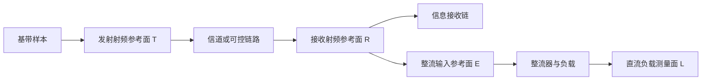

# U06 硬件前参考平面与测量记录模板

2026-11-06；状态：待设备确认的实验设计模板。用户已回复设备型号与可用时间尚未确认。此模板没有授权实际发射，也不声明存在可用硬件、标定结果或DC输出。

## 先定义同一物理环境

仿真中可对候选复用完全相同的 $h$ 和离散噪声样本 $n$。硬件中接收机本底热噪声与器件噪声不可假定逐次完全相同：若使用可编程信道/数字注入噪声，可重放指定信道和注入噪声记录，但仍须测量并说明不可重放的硬件噪声；若为空口，则记录信道估计、测量时间和相干时间，交错或随机化策略顺序，按实际信道分组并报告不完全配对，不写成逐样本相同 $h,n$。先以实际设备能力和共同时间窗冻结比较协议。

## 信号路径及参考平面

图为测量定义，**不代表实际分路损耗为零或设备已经具备**。若信息和能量分支通过功分器并行，分别记录分路比、插损与频率依赖，换算各支路实际参考面；若采用切换或分别测量，记录时间差、重复性和不确定度，不假定两次波形完全一致。仪表能测什么、是否需要探头或耦合器，需由具体设备手册及实验室规范决定。

| 面 | 应记录 | 未完成前不能声称 |
|---|---|---|
| T | 数字幅度、采样率/带宽、中心频率、增益、波形/固件hash、实测平均功率及参考阻抗、测量带宽 | 数字归一幅度等于实际天线口功率 |
| R | 连接方式/信道、接收参考功率、带宽、信道估计与时间戳、背景噪声及其测量方法 | 所有策略遇到相同瞬时空口信道和噪声 |
| E | 支路插损、阻抗和失配、频率、实际入整流器的RF功率及测量不确定度 | R面的功率全部进入整流器 |
| L | 负载型号/阻值、直流电压及其时间平均、测量负担和不确定度 | 接收RF均方就是负载DC功率 |
| 信息接收端 | 接收采样、同步/信道估计、译码配置、参考消息、信息位数、错位数、帧数及丢失帧处理 | 仿真比特型Goodput等于硬件净包吞吐 |

电阻负载近似且电压纹波、测量负担可忽略时，可讨论 $P_{L}=\langle v_L(t)^2\rangle/R_L$；仅用平均电压平方计算需确认纹波影响。若负载非电阻或功耗随时间变化，按实际电压电流波形求平均功率。效率的分母必须明确为 E 面同一时间窗口的实际输入功率，且待负载、阻抗和测量链核实后再计算；模型中的电流代理不能当作测得的 $P_L$。

## 设备确认后的校准与执行顺序

1. 登记设备型号、固件、仪器证书/校准日期、端口和额定值；依具体设备核对频率、带宽、幅度、负载与允许连接，形成明确接线图。型号未知时这些字段均记“待确认”，不填写猜测值。
2. 在符合设备规格的受控条件下标定T→R、R→E各段的频率相关损耗和参考面；记录线缆、衰减、分路、测量时序及不确定度。若复用相同线缆配置仍需记录其版本和变化。
3. 建立数字回环与已知样本向量，分别核对调制/映射、OFDM参数、同步、信道估计、译码及误码分母；硬件同步丢帧和CRC净包吞吐须另有定义，不将现有仿真Goodput直接替代。
4. 在实际工作频率和负载下对整流路径进行设备可行的RF输入—负载电压/电流标定；记录输入功率、波形、阻抗、负载、温度和稳定时间。二极管截断模型的有效范围和系数必须有器件/仿真/测量证据，不从归一化代理直接认定。
5. 冻结策略、基线、信道处理、测量顺序、错误分母及统计单位。对于实际不完全配对，按预先注册的环境标签/时序配对；训练、校准和测试样本不混用。先实施适合设备能力的短链路检查，再根据结果与预算单独安排硬件实验。

## 单次记录最小字段

| 类别 | 字段 |
|---|---|
| 追溯 | run_id、时间、操作者、协议/代码/波形哈希、设备与仪表型号、固件、校准记录 |
| 策略 | 16QAM映射、N/K/I/S/F、各组p、OFDM载波/CP、训练策略版本、基线ID、随机种子或载荷向量标识 |
| 时间频率 | 中心频率、采样率、占用带宽、采集起止、稳态窗口、重复编号、顺序 |
| 信道噪声 | 信道实现或估计值与时间、重放标识、噪声注入设置、接收机本底噪声及测量带宽、配对关系 |
| 射频 | T/R/E参考面、实测功率、分路/线缆/衰减损耗、阻抗、量程及不确定度 |
| 信息 | 有效信息位、比特错误、帧/包数、同步失败或丢帧、CRC设置、资源时间及分母 |
| 能量 | 整流器、负载与连接、负载电压/电流波形或统计量、稳态时间、温度、DC负载功率及不确定度 |
| 完整性 | 原始采样/日志路径、异常/超量程、无效数据原因及排除规则、软件版本和摘要 |

## 当前状态

数字原型和探索代理存在，正式模型/策略独立测试未验收；整流器、USRP及仪器资料未知，输入范围与标定条件未确定。该模板可用于核对缺口，但不能视为硬件实验已准备完毕。

## 2026-11-06 暂停整理：最新状态入口

本文件保留当时的专题证据；后续实现和限制已集中到[README](README.md)及[进度表末尾v87](进度表.md)。当前Goal暂停，专题中的smoke/探索结果不表示正式验收。恢复先按next_plan末尾进行整体审查。

## 2026-11-10 归档定位（历史正文不改写）

本文件退出当前执行入口，原状态/预算/命令仅反映历史，不构成新运行授权。当前路线见[研究路线](../当前研究路线-2026-11-10.md)，全部迁移位置见[归档索引](README.md)。上文相对链接保留为迁移前历史；当前有效引用如下。

- [README](../README.md)
- [进度表末尾v87](../进度表.md)
